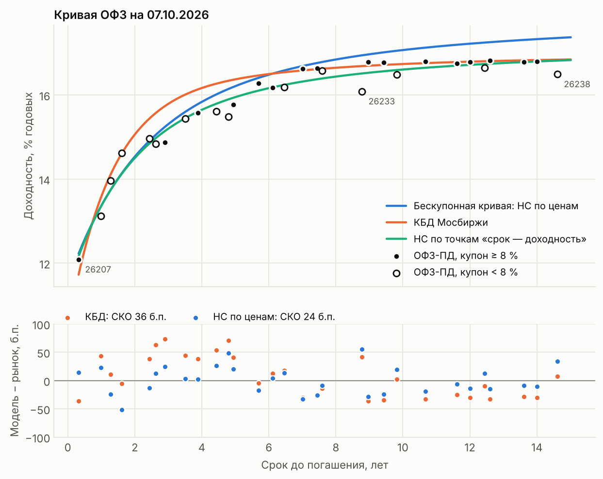
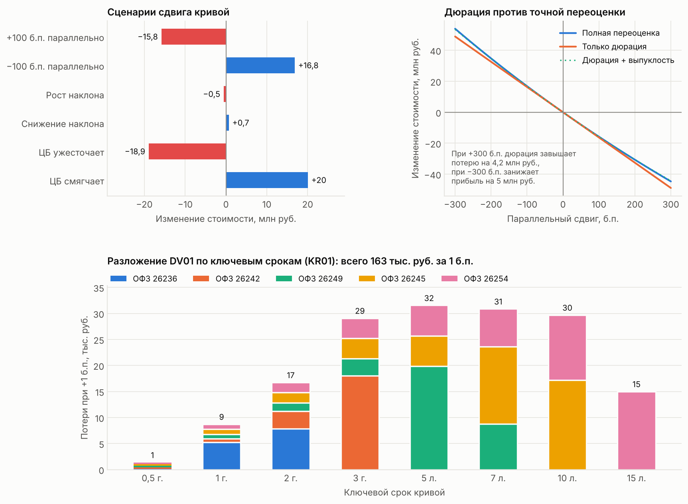
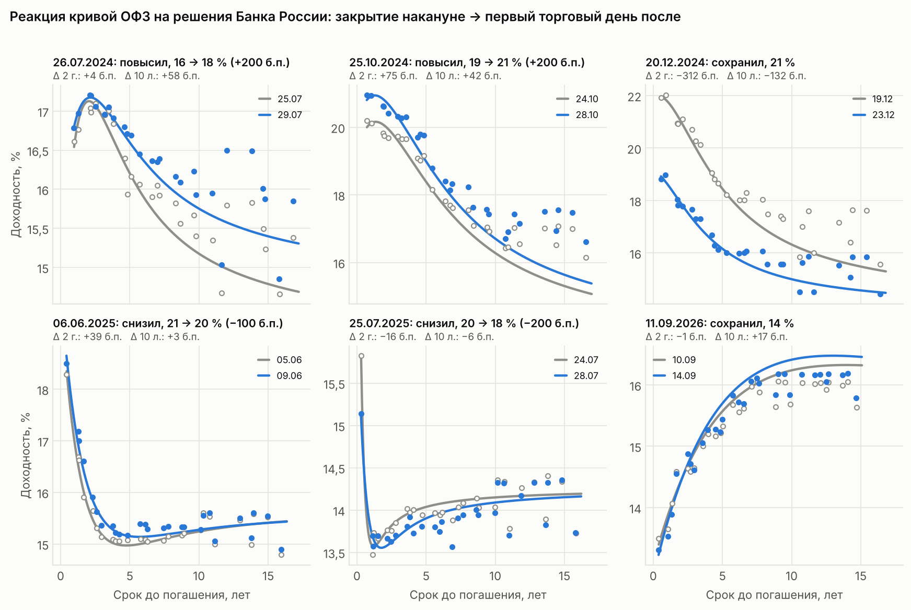
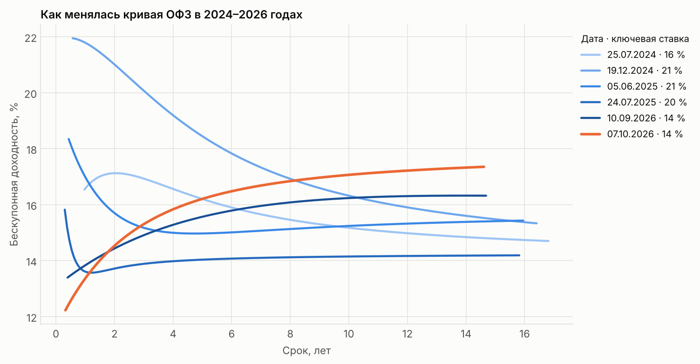

# Кривая доходности ОФЗ и риск портфеля облигаций

Строю кривую бескупонной доходности ОФЗ по модели Нельсона-Сигеля на данных Мосбиржи, сравниваю её с официальной КБД, считаю риск портфеля из пяти ОФЗ (дюрация, выпуклость, DV01, сценарии, разложение по ключевым срокам) и смотрю, как кривая реагировала на решения Банка России в 2024–2026 годах.

Все расчёты — свои: доходность, НКД, дюрация и DV01 считаются по купонному графику каждой бумаги, а затем сверяются с числами, которые публикует биржа.

**Главное (срез на 07.10.2026, 30 выпусков ОФЗ-ПД):**

* Собственная доходность к погашению совпадает с биржевой до округления: медиана 0,25 б.п., максимум 0,5 б.п. на 366 наблюдениях за 13 дат.
* Кривая Нельсона-Сигеля, подогнанная к ценам, ближе к ценам закрытия, чем КБД Мосбиржи: СКО ошибки по доходности 24 б.п. против 36 б.п. (сравнение на тех же данных, к которым подогнана кривая; так на всех 13 датах). На длинном конце основная часть ошибки — **купонный эффект**: старые выпуски с купоном 6–7 % торгуются на 30–70 б.п. ниже по доходности, чем новые с купоном 12–13 %.
* Портфель на 500 млн руб. (ОФЗ 26236, 26242, 26249, 26245, 26254): DV01 ≈ 165 тыс. руб. за 1 б.п., модифицированная дюрация 3,3 года. При +100 б.п. по всей кривой теряет 15,8 млн руб., при −100 б.п. зарабатывает 16,8 млн: разница — это выпуклость.
* Самая сильная реакция кривой из разобранных заседаний — 20.12.2024, когда ЦБ сохранил ставку 21 % вместо ожидавшегося повышения: за два торговых дня короткие доходности упали на ≈ 3 п.п.

## Кривая на 07.10.2026



* **Синяя** — бескупонная кривая: каждую ОФЗ раскладываем на платежи и дисконтируем их по модели, параметры подбираем так, чтобы модельные цены совпали с рыночными.
* **Зелёная** — та же модель, подогнанная «в лоб» к точкам «срок → доходность к погашению». Это гладкая кривая YTM, а не бескупонная, поэтому на длинном конце она ниже: доходность купонной бумаги — «среднее» бескупонных ставок по всем её платежам, а при растущей кривой ближние платежи дисконтируются по более низким ставкам.
* **Оранжевая** — КБД Мосбиржи, восстановленная по опубликованным параметрам (совпадает со значениями биржи до 0,0001 %). Внизу видно, что КБД ошибается сильнее: у биржи свой набор бумаг и свои веса. Это видно и по данным самой биржи: в блоке `securities` эндпоинта `zcyc` расчётная доходность ОФЗ 26242 по КБД на 07.10.2026 — 15,60 % при фактической 14,91 %.
* Пустые кружки — выпуски с купоном ниже 8 %. На длинном конце они систематически лежат ниже остальных: это и есть купонный эффект, который одна кривая на все бумаги описать не может. Наша кривая проходит между двумя группами (+22 и −18 б.п. в среднем для бумаг от 7 лет), КБД — почти по старым выпускам (+6 б.п.) и на ≈ 31 б.п. ниже новых.

| Срок | 0,5 г. | 1 г. | 2 г. | 3 г. | 5 л. | 7 л. | 10 л. | 15 л. |
|---|---|---|---|---|---|---|---|---|
| НС по ценам, % | 12,56 | 13,37 | 14,53 | 15,31 | 16,21 | 16,69 | 17,07 | 17,37 |
| КБД, % | 12,31 | 13,58 | 15,06 | 15,79 | 16,37 | 16,58 | 16,74 | 16,85 |

Параметры: β0 = 17,98 %, β1 = −6,43 %, β2 ≈ 0, τ = 1,42 года. Горба в октябре 2026 нет — проверено, что β2 = 0 действительно оптимум, а не застревание оптимизатора.

## Риск портфеля

По 100 млн руб. в самый ликвидный выпуск возле сроков 1,5 / 3 / 5 / 10 / 15 лет.



| Выпуск | Погашение | YTM, % | D mod | Выпуклость | DV01 позиции, тыс. руб. |
|---|---|---|---|---|---|
| ОФЗ 26236 | 17.05.2028 | 14,62 | 1,33 | 3,0 | 13,3 |
| ОФЗ 26242 | 29.08.2029 | 14,87 | 2,23 | 7,3 | 22,3 |
| ОФЗ 26249 | 16.06.2032 | 16,28 | 3,51 | 18,3 | 35,1 |
| ОФЗ 26245 | 26.09.2035 | 16,79 | 4,57 | 32,2 | 45,7 |
| ОФЗ 26254 | 03.10.2040 | 16,80 | 4,91 | 44,4 | 49,1 |
| **Портфель** | | **16,26** (IRR) | **3,31** | **21,0** | **165,5** |

Сценарии считаются полной переоценкой: каждый платёж дисконтируется по сдвинутой бескупонной кривой, а z-спред каждой бумаги к кривой держится постоянным (так при нулевом сдвиге получается ровно рыночная цена).

| Сценарий | Сдвиг кривой | Портфель, млн руб. |
|---|---|---|
| +100 б.п. | вся кривая | −15,8 |
| −100 б.п. | вся кривая | +16,8 |
| Рост наклона | до 1 г. −50 б.п., от 10 л. +50, между — линейно | −0,5 |
| Снижение наклона | до 1 г. +50, от 10 л. −50 | +0,7 |
| ЦБ ужесточает | короткие +200, длинные +50 | −18,9 |
| ЦБ смягчает | короткие −200, длинные −50 | +20,0 |

**Выводы.** Дюрация — линейное приближение: на ±300 б.п. она ошибается на 4–5 млн руб., причём сильнее при снижении ставок; поправка на выпуклость убирает почти всю ошибку. Доходность портфеля считается как IRR всех его платежей: 16,26 %, а не средневзвешенная YTM бумаг (15,87 %), которая при растущей кривой её занижает. Самая длинная бумага портфеля (2040 г.) имеет модифицированную дюрацию меньше 5 лет — при купоне 13 % и доходности ≈ 17 % основная стоимость сидит в ближних купонах. Изменения наклона портфелю почти безразличны: риск размазан по кривой, и разложение по ключевым срокам (KR01) показывает, что он сосредоточен на участке 3–10 лет. Сумма KR01 (163 тыс.) сходится с DV01 по доходностям (165 тыс.).

## Кривая вокруг решений Банка России

Окно: закрытие накануне решения → закрытие первого торгового дня после него. Изменения считаю тремя способами: по своей кривой, по КБД и без всякой модели — медианное изменение доходности одних и тех же бумаг.



| Заседание | Ставка, % | НС 2 г. | НС 10 л. | КБД 2 г. | КБД 10 л. | ОФЗ до 3 лет | ОФЗ 3–7 лет | ОФЗ от 7 лет |
|---|---|---|---|---|---|---|---|---|
| 26.07.2024 | 16 → 18 | +4 | +58 | +27 | +61 | +18 | +39 | +53 |
| 25.10.2024 | 19 → 21 | +75 | +42 | +71 | +54 | +79 | +62 | +48 |
| 20.12.2024 | 21 → 21 | −312 | −132 | −339 | −140 | −307 | −237 | −172 |
| 06.06.2025 | 21 → 20 | +39 | +3 | +36 | +7 | +32 | +24 | +7 |
| 25.07.2025 | 20 → 18 | −16 | −6 | 0 | −5 | −13 | −18 | −7 |
| 11.09.2026 | 14 → 14 | −1 | +17 | +6 | +21 | −3 | +10 | +14 |

*Изменения в б.п.*

* **Июль 2024, +200 б.п.** Доходности коротких бумаг выросли лишь на ≈ 20 б.п. — повышение уже было в ценах; сильнее распродавались длинные.
* **Октябрь 2024, +200 б.п. до 21 %.** Медвежье уплощение: короткие +80 б.п., длинные +40–50. Кривая глубоко инвертирована.
* **Декабрь 2024, пауза на 21 %.** Рынок закладывал повышение — короткие доходности упали на 3 п.п., длинные на 1,3–1,7 п.п.
* **Июнь 2025, первое снижение.** Доходности *выросли*: снижение было ожидаемым, рынок «продал факт».
* **Июль 2025, −200 б.п.** Реакция −10…−20 б.п.: почти всё уже было в ценах.
* **Сентябрь 2026, пауза на 14 %.** Короткий конец на месте, длинный +15–20 б.п.



За два года кривая прошла путь от глубокой инверсии (декабрь 2024: 22 % на коротком конце, 15 % на длинном) к нормальной восходящей форме (октябрь 2026: 12 % → 17 %).

## Как это посчитано

**Конвенции Мосбиржи для ОФЗ.** Сроки ACT/365; доходность эффективная годовая: P = Σ CFᵢ / (1 + y)^tᵢ, где P — грязная цена (чистая цена + НКД); расчёты T+1. В истории торгов ISS поле `ACCINT` — НКД на дату *торгов*, а не расчётов. Если сложить с ним цену, доходность разойдётся с биржевой примерно на 1 б.п. Поэтому НКД пересчитывается на дату расчётов.

**Модель.** Бескупонная ставка z(t) = β0 + β1·(1 − e^(−t/τ))/(t/τ) + β2·[(1 − e^(−t/τ))/(t/τ) − e^(−t/τ)], дисконт-фактор (1 + z(t))^(−t). Подгонка — `scipy.optimize.least_squares` с мультистартом по τ (по τ целевая функция невыпуклая). Невязка бумаги — ошибка цены, делённая на P·D_mod, то есть ошибка в доходности: так длинные бумаги не перевешивают короткие. τ ограничен 5 годами: при большом τ модель вырождается (β0 уходит в минус, β1 и β2 гасят друг друга), внутри диапазона кривая почти та же, но параметры теряют смысл. На сентябрьских датах 2026 года τ упирается в эту границу, ошибка растёт лишь на ≈ 1 б.п.

**Риск.** D_mod = D_Mac/(1 + y), выпуклость C = Σ tᵢ(tᵢ + 1)·CFᵢ·(1 + y)^(−tᵢ−2) / P, DV01 = D_mod·P·0,0001. KR01 — потеря при сдвиге на 1 б.п. треугольником вокруг одного ключевого срока; треугольники в сумме дают параллельный сдвиг.

**Проверки** (`tests/`, 22 теста):

| Что сверяется | Результат |
|---|---|
| Доходность к погашению против `YIELDCLOSE` биржи, 366 наблюдений | медиана 0,25 б.п., максимум 0,5 б.п. (биржа округляет до 1 б.п.) |
| НКД против `ACCINT` | до копейки |
| Дюрация Маколея против `DURATION` биржи (биржа считает её по средневзвешенной цене) | расхождение ≤ 1 дня |
| КБД по параметрам против опубликованных значений | ≤ 0,0001 % |
| Аналитические DV01 и выпуклость против численных производных | совпадают до 10⁻⁵ |
| Подгонка НС на ценах, сгенерированных по известной кривой | параметры восстанавливаются до 10⁻⁴ |
| Сумма KR01 против параллельного сдвига на 1 б.п. | совпадают |
| Разбор ответов ISS API (на подменённых ответах), постраничная загрузка, кэш | работает без сети |

Одно найденное исключение: для ОФЗ 26229 в июле 2025 года (≈ 0,3 года до погашения) биржа показывает *простую* доходность 15,02 %, а не эффективную 15,82 %, как для остальных бумаг. Это зафиксировано отдельным тестом.

## Структура

```
ofz/
  moex.py      загрузка из ISS API Мосбиржи с кэшем в data/
  bonds.py     потоки, НКД, доходность, дюрация, выпуклость, DV01
  curve.py     Нельсон-Сигель, подгонка по доходностям и по ценам, КБД
  market.py    срез рынка на дату: таблица метрик по бумагам
  risk.py      портфель, сценарии, z-спред, KR01
  history.py   решения Банка России и реакция кривой
  plots.py     графики
notebooks/ofz_analysis.ipynb   весь анализ по шагам, с выводами
scripts/make_figures.py        пересобрать графики в figures/
tests/                         проверки против данных биржи
data/                          кэш: котировки, купонные графики, параметры КБД
```

## Запуск

```bash
pip install -r requirements.txt
pytest                                   # 22 теста, без сети
python scripts/make_figures.py           # графики из кэша data/
jupyter notebook notebooks/ofz_analysis.ipynb
```

Новые даты подгружаются из ISS автоматически, если не включать офлайн-режим:

```python
from ofz.moex import MoexData
from ofz.market import MarketSnapshot

snap = MarketSnapshot.load("2026-10-08", MoexData())   # скачает и допишет в data/
fit = snap.fit_prices()
```

или `python scripts/make_figures.py --date 2026-10-08 --online`. История торгов в ISS появляется после закрытия дня, так что берите последний завершённый торговый день.

## Ограничения и что можно улучшить

* **Купонный эффект** — главный источник ошибки на длинном конце. Можно добавить в модель фактор купона или строить отдельные кривые для старых и новых выпусков.
* **Свенссон** (6 параметров, второй горб) лучше описал бы короткий участок, где сейчас ошибки до 50 б.п.
* **Праздники.** Дата расчётов T+1 учитывает только выходные. Для дат перед праздниками НКД будет отличаться на день.
* **Только ОФЗ-ПД.** Флоатеры (ОФЗ-ПК), линкеры (ОФЗ-ИН) и амортизируемые выпуски не используются.
* **Окно событий** — закрытие к закрытию. Внутридневные данные показали бы реакцию в минуты после решения.

## Данные

* [ISS API Московской биржи](https://iss.moex.com/iss/reference/) — итоги торгов, купонные графики, параметры КБД.
* [Банк России — ключевая ставка](https://www.cbr.ru/hd_base/KeyRate/) — даты и решения заседаний.
